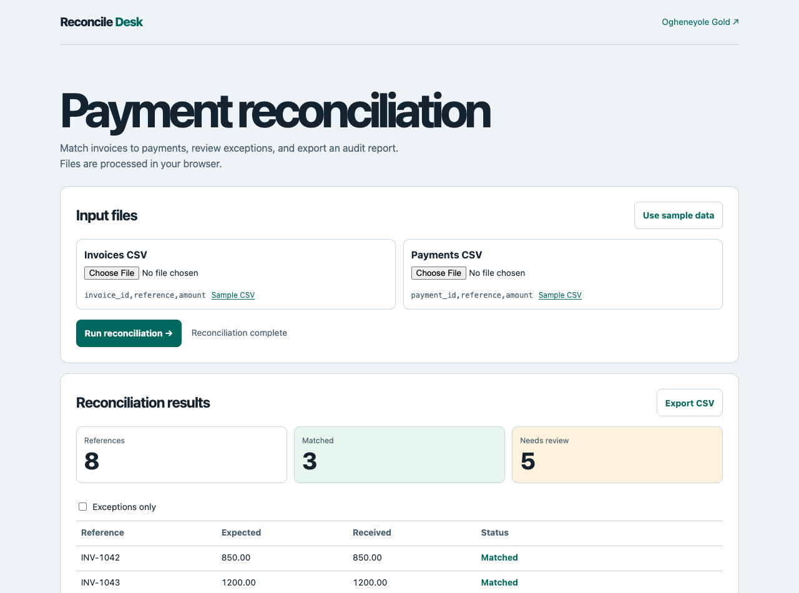

# Reconcile Desk

Match invoice and payment CSVs by reference, flag exceptions, and download a reconciliation report. The demo uses synthetic invoices and payments. No account, API key, or backend is required.



## Run locally

Serve this directory over HTTP, then open http://127.0.0.1:4188/ and choose **Use sample data** followed by **Run reconciliation**.

```sh
python3 -m http.server 4188 --bind 127.0.0.1
```

The sample produces eight reference groups. Three match and five require review. One match combines two payments. The five exceptions cover missing, underpaid, overpaid, duplicate-reference, and unlinked records.

## Rules and limits

- Each input has at most 5,000 records and is at most 1 MB. Use one currency per run. Amounts accept up to two decimal places and are processed as integer cents.
- Invoice headers are `invoice_id,reference,amount`. Payment headers are `payment_id,reference,amount`. IDs must be unique within each file. References are trimmed and matched case-insensitively.
- The engine groups records by exact normalized reference. It combines payments within each group and flags ambiguous duplicate invoices for review. It does not move money or infer a match from amount alone.
- The UI reads local CSVs and passes their text to a Web Worker. The worker validates and reconciles the records, then returns results. File contents are processed locally. Export is generated in the browser and escapes spreadsheet formula prefixes.
- The static site works on GitHub Pages under a repository subpath. A local web server is needed for module workers during development.

## Tests

```sh
node --test engine.test.mjs
```
